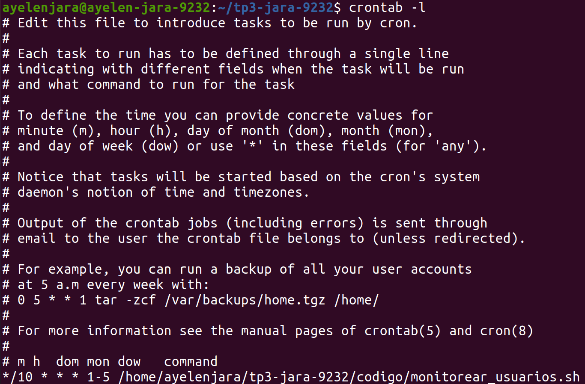
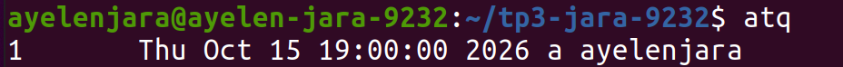
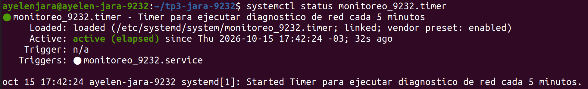
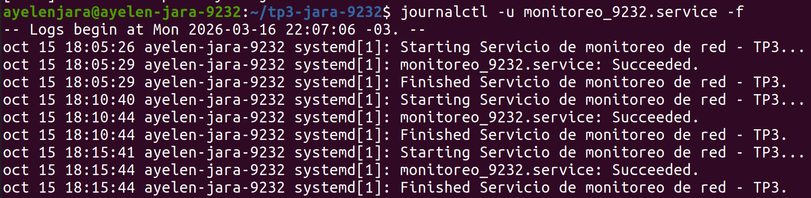
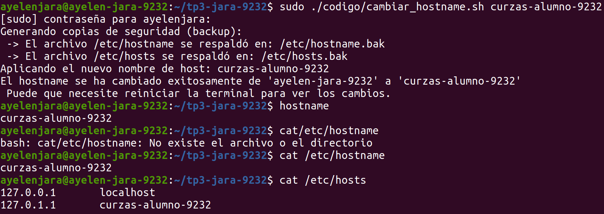
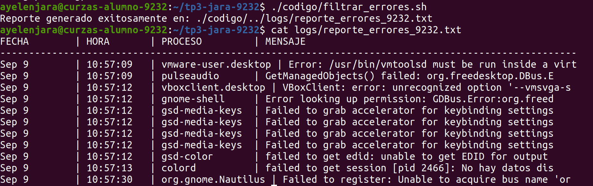

# Trabajo Práctico N° 3 -  Cron, At, Systemd Timers y Procesamiento de Texto

**Carrera:** Tecnicatura Universitaria en Administración de Sistemas y Software Libre  
**Asignatura:** Automatización y Scripting  
**Alumna:** Jara Ayelen  
**Legajo N°:** 9232  

## Descripción
El presente repositorio contiene la resolución del Trabajo Práctico N° 3 de la asignatura Automatización y Scripting. El mismo se enfoca en la administración avanzada de sistemas Linux mediante la programación de tareas periódicas y diferidas (`cron` y `at`), la recolección de datos del sistema, la modificación segura de archivos de configuración utilizando `sed`, y el análisis y formateo de registros del sistema (`syslog`) mediante el uso de `awk`.

---

## Evidencias de Ejecución y Validaciones

A continuación se documentan las pruebas de funcionamiento de cada uno de los scripts y configuraciones desarrolladas durante el trabajo práctico.

### Tarea 1 y 2: Programación de Tareas con Cron y At
Configuración del demonio cron para la ejecución periódica de scripts de monitoreo y programación de tareas de ejecución única mediante el comando `at`.

 
<em>Listado de tareas programadas en el crontab del usuario.</em>

 
<em>Validación de tareas encoladas en el sistema.</em>

### Tarea 3: Automatización con Systemd (Timers y Servicios)
Creación y configuración de un servicio personalizado (`monitoreo_9232.service`) y su respectivo temporizador (`monitoreo_9232.timer`) en systemd, encargados de automatizar la ejecución de un script de diagnóstico de red en intervalos regulares de 5 minutos.

 
<em>Comprobación del estado activo y la correcta carga del timer mediante systemctl.</em>

 
<em>Verificación de las ejecuciones periódicas del servicio de red utilizando journalctl.</em>

### Tarea 4: Configuración Segura de Hostname
Uso del script `cambiar_hostname.sh` evaluando la validación de privilegios y la actualización automatizada de los archivos `/etc/hostname` y `/etc/hosts` utilizando `sed`.

 
<em>Validación de seguridad sin privilegios y ejecución exitosa con sudo.</em>

### Tarea 5: Parser de Registros Syslog
Procesamiento del archivo `/var/log/syslog` mediante `awk` para extraer y formatear errores, fallos y advertencias críticas en un reporte de ancho fijo.

 
<em>Salida del archivo reporte_errores_9232.txt generado por el script.</em>
